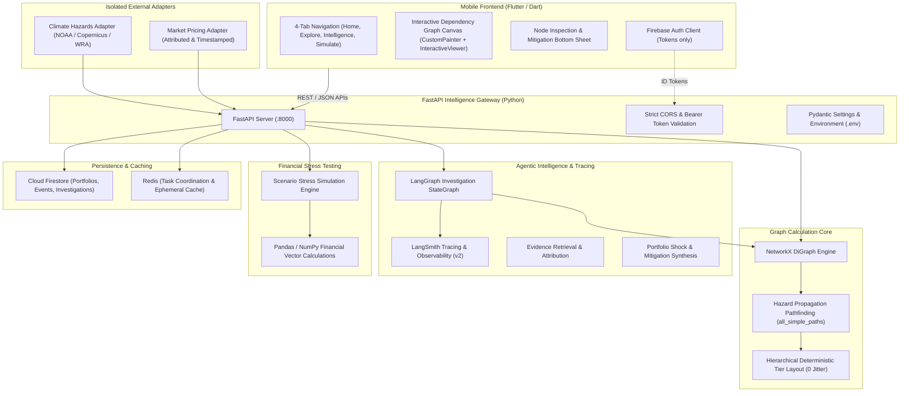

# CLIMATWIN — Target Architecture & Technical Specification

CLIMATWIN is a mobile-first, agentic climate-risk intelligence platform for investment portfolios. This document details the system topology, graph calculation engine, agentic workflows, security boundary, and data pipeline.

---

## 1. System Topology & Component Architecture

---

## 2. Dependency Graph Architecture

The graph is a core analytical capability of CLIMATWIN, not a decorative visualization.

### Node Typing
1. `climate_hazard`: Physical hazard events (drought, flood, low river water, wildfire).
2. `geographic_region`: Spatial jurisdiction or watershed (Hsinchu Science Park, Upper Rhine Valley).
3. `facility`: Key operational site (Fab 12 semiconductor foundry, Ludwigshafen chemical plant).
4. `commodity`: Critical inputs or materials (ultrapure water, silicon wafers).
5. `transport_route`: Logistical bottlenecks (Rhine freight barge corridor).
6. `supplier`: Tier-1 / Tier-2 suppliers (TSMC, BASF).
7. `company`: Direct portfolio company / public equity (Apple, NVIDIA, BMW).
8. `customer`: Ultimate portfolio fund or asset owner.

### Edge Typing & Labels
- `supplies_to`: Supply relationship with contract tier and lead time.
- `depends_on`: Financial or holding dependency.
- `located_in`: Physical presence within a geography or watershed.
- `exposed_to`: Spatial overlap with a climate hazard.
- `transports`: Corridors conveying raw materials.
- `produces`: Asset manufacturing output.
- `owns`: Corporate ownership of infrastructure.

### Deterministic Layout Engine
To ensure visual stability on mobile screens and eliminate layout jitter:
- **Hierarchical Topological Tiers**: Nodes are partitioned into 5 horizontal tiers:
  - Tier 0: Climate Hazards
  - Tier 1: Geographic Regions & Facilities
  - Tier 2: Transport Routes, Commodities & Suppliers
  - Tier 3: Portfolio Companies
  - Tier 4: Portfolio Funds
- **Stable Coordinate Allocation**: Nodes are sorted deterministically and spaced uniformly along orthogonal axes, with precalculated `(x, y)` coordinates provided to the frontend.

### Mobile Canvas Implementation
- **Renderer**: Flutter native `InteractiveViewer` combined with a specialized `CustomPainter`.
- **Interactions**:
  - Pan, smooth 60 FPS zoom (`0.4x` to `2.5x`), fit-to-screen toggle.
  - Node selection with persistent highlight ring.
  - Bottom sheet modal detailing transmission path, attributes, and mitigation triggers.
  - Filter chips for risk levels (`All`, `High & Critical`, `Critical`) and hazard propagation paths.

---

## 3. Server-Side Agent Architecture (LangGraph + LangSmith)

- **Agent Runtime**: LangGraph `StateGraph` compiled workflow.
- **Workflow Steps**:
  1. `retrieve_evidence`: Gathers source-attributed news, satellite, and meteorological readings.
  2. `traverse_graph_impact`: Traverses NetworkX graph to trace physical hazard exposure across supply chain tiers to portfolio equities.
  3. `assess_portfolio_risk`: Calculates weighted revenue at risk and estimated portfolio drawdown.
  4. `synthesize_mitigations`: Generates actionable hedging, supplier diversification, and scenario branches.
- **Observability**: Tracing hooked through standard LangSmith environment variables (`LANGCHAIN_TRACING_V2=true`, `LANGCHAIN_PROJECT=climatwin`). LangSmith serves purely as the observability and evaluation layer.

---

## 4. Security & Environment Perimeter

- **Mobile App Isolation**: No LLM API keys, service account private keys, or administrative tokens are bundled in the Flutter application.
- **Backend Configuration**: All credentials managed via `.env` files (loaded through `pydantic-settings` / `os.environ`), with template provided in `.env.example`.
- **Authentication**: Firebase Authentication manages client tokens; server verifies tokens on sensitive endpoints.
- **Secret Hygiene**: `.gitignore` strictly protects `.env`, `*.json` credentials, build output, and local caches.
