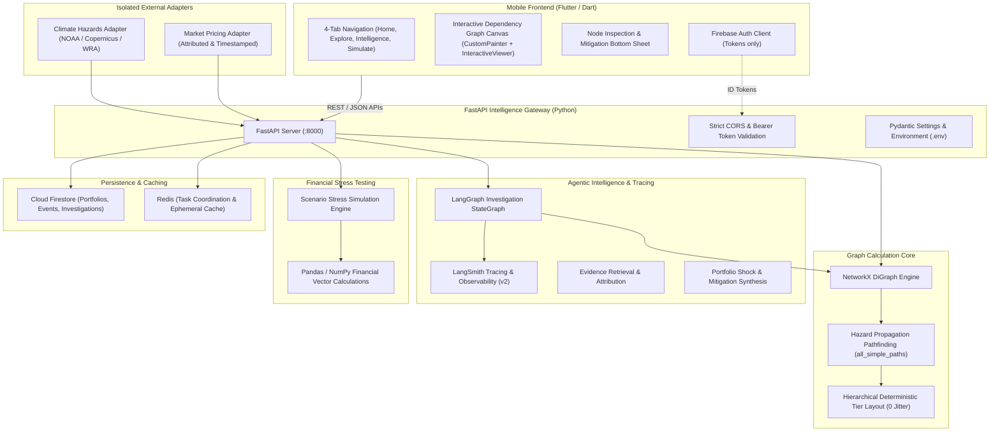

# CLIMATWIN — Target Architecture & Technical Specification

CLIMATWIN is a mobile-first, agentic climate-risk intelligence platform for investment portfolios. This document details the system topology, graph calculation engine, agentic workflows, security boundary, and data pipeline.

---

## 1. System Topology & Component Architecture

---

## 2. Dependency Graph Architecture

The graph is a core analytical capability of CLIMATWIN, not a decorative visualization.

### Node Typing
1. `climate_hazard`: Physical hazard events (drought, flood, low river water, wildfire).
2. `geographic_region`: Spatial jurisdiction or watershed (Hsinchu Science Park, Upper Rhine Valley).
3. `facility`: Key operational site (Fab 12 semiconductor foundry, Ludwigshafen chemical plant).
4. `commodity`: Critical inputs or materials (ultrapure water, silicon wafers).
5. `transport_route`: Logistical bottlenecks (Rhine freight barge corridor).
6. `supplier`: Tier-1 / Tier-2 suppliers (TSMC, BASF).
7. `company`: Direct portfolio company / public equity (Apple, NVIDIA, BMW).
8. `customer`: Ultimate portfolio fund or asset owner.

### Edge Typing & Labels
- `supplies_to`: Supply relationship with contract tier and lead time.
- `depends_on`: Financial or holding dependency.
- `located_in`: Physical presence within a geography or watershed.
- `exposed_to`: Spatial overlap with a climate hazard.
- `transports`: Corridors conveying raw materials.
- `produces`: Asset manufacturing output.
- `owns`: Corporate ownership of infrastructure.

### Deterministic Layout Engine
To ensure visual stability on mobile screens and eliminate layout jitter:
- **Hierarchical Topological Tiers**: Nodes are partitioned into 5 horizontal tiers:
  - Tier 0: Climate Hazards
  - Tier 1: Geographic Regions & Facilities
  - Tier 2: Transport Routes, Commodities & Suppliers
  - Tier 3: Portfolio Companies
  - Tier 4: Portfolio Funds
- **Stable Coordinate Allocation**: Nodes are sorted deterministically and spaced uniformly along orthogonal axes, with precalculated `(x, y)` coordinates provided to the frontend.

### Mobile Canvas Implementation
- **Renderer**: Flutter native `InteractiveViewer` combined with a specialized `CustomPainter`.
- **Interactions**:
  - Pan, smooth 60 FPS zoom (`0.4x` to `2.5x`), fit-to-screen toggle.
  - Node selection with persistent highlight ring.
  - Bottom sheet modal detailing transmission path, attributes, and mitigation triggers.
  - Filter chips for risk levels (`All`, `High & Critical`, `Critical`) and hazard propagation paths.

---

## 3. Server-Side Agent Architecture (LangGraph + LangSmith)

- **Agent Runtime**: LangGraph `StateGraph` compiled workflow.
- **Workflow Steps**:
  1. `retrieve_evidence`: Gathers source-attributed news, satellite, and meteorological readings.
  2. `traverse_graph_impact`: Traverses NetworkX graph to trace physical hazard exposure across supply chain tiers to portfolio equities.
  3. `assess_portfolio_risk`: Calculates weighted revenue at risk and estimated portfolio drawdown.
  4. `synthesize_mitigations`: Generates actionable hedging, supplier diversification, and scenario branches.
- **Observability**: Tracing hooked through standard LangSmith environment variables (`LANGCHAIN_TRACING_V2=true`, `LANGCHAIN_PROJECT=climatwin`). LangSmith serves purely as the observability and evaluation layer.

---

## 4. Security & Environment Perimeter

- **Mobile App Isolation**: No LLM API keys, service account private keys, or administrative tokens are bundled in the Flutter application.
- **Backend Configuration**: All credentials managed via `.env` files (loaded through `pydantic-settings` / `os.environ`), with template provided in `.env.example`.
- **Authentication**: Firebase Authentication manages client tokens; server verifies tokens on sensitive endpoints.
- **Secret Hygiene**: `.gitignore` strictly protects `.env`, `*.json` credentials, build output, and local caches.

---

## 5. Phase 4 Dataset Integrations, Risk Engine & Alerting

### World Bank CCKP CMIP6 Climate Timeseries
- **Endpoint**: `https://cckpapi.worldbank.org/api/v1/cmip6-x0.25_timeseries_tas,pr,spei12_timeseries_annual_1950-2014,2015-2100_mean,median,p10,p90_ssp245,ssp585_ensemble_all_mean/global_countries?_format=json`
- **Variables**: Surface air temperature (`tas` in °C), annual precipitation (`pr` in mm/yr), 12-month drought index (`spei12`, dimensionless).
- **Ensemble Percentiles**: `p10`, `median`, `p90` representing CMIP6 multi-model distribution statistics across models, not deterministic bounds.
- **Scenarios**: `historical` (1950–2014 baseline observations) strictly separated from `ssp245` (Middle of the Road) and `ssp585` (Fossil-fueled Development) 2015–2100 projections.
- **Geographic Mapping**: Strictly matched via ISO3 codes (e.g. `TWN` for Taiwan, `USA`, `DEU`), with zero silent substitution.
- **Caching**: 24-hour TTL with durable JSON state fallback.

### Sectivia U.S. Supply-Chain Graph (CC BY 4.0)
- **Datasets**: `datasets/sectivia-supply-chain.json`, `sectivia-companies.csv`, `sectivia-relations.csv`.
- **Direction**: Supplier $\longrightarrow$ Customer directed edges (e.g. `TSMC` $\rightarrow$ `NVDA` $\rightarrow$ `AMZN`).
- **Attribution**: `"Supply-chain data: Sectivia (https://sectivia.com), CC BY 4.0"` preserved across all nodes and edges.
- **Disclaimers**: Supply-chain connections represent researched commercial relationships; they do NOT imply climate damage or financial loss.
- **Reconciliation**: Reconciles 215 companies and 350 relations into NetworkX without altering core node IDs (`comp_nvidia`, `sup_tsmc`, `comp_apple`).

### Deterministic Quantitative Risk Engine (Python)
- **Framework**: Hazard-Exposure-Vulnerability ($H \in [0,100], E \in [0,100], V \in [0,100]$):
  $$\text{Composite Risk} = w_H \cdot H + w_E \cdot E + w_V \cdot V$$
- **Provisional Weights**: $w_H = 0.35, w_E = 0.35, w_V = 0.30$ (transparently disclosed in response metadata).
- **Financial Arithmetic**: Computed purely in Python. Unmitigated loss vs. dual-sourcing and adaptation buffer savings.
- **LLM Constraint**: Gemini Flash Lite is invoked strictly upon explicit "Calculate Risk" triggers to synthesize transmission mechanisms without altering precomputed numbers.

### Live Telemetry, Caching & Push Delivery
- **GDELT 2.0**: Live search for climate disruptions with URL SHA-256 deduplication and 25-minute TTL caching.
- **Open-Meteo**: High-resolution weather observations cached with 25-minute TTL.
- **Firebase Cloud Messaging (FCM)**:
  - User-scoped device token registration in durable state.
  - Strict delivery status tracking: `"delivered"` vs. `"stored_only"` (when awaiting server credentials).
  - Android foreground alert banners and direct notification tap navigation to risk investigations.

---

## 6. Phase 3.5: Risk Calibration & Explainable AI Architecture

### Empirical Dataset Audit & Integrity Policy
- **Dataset Audit Findings**: A systematic audit of repository datasets (`datasets/sectivia-companies.csv`, `sectivia-relations.csv`, `sectivia-supply-chain.json`) established that 0 empirical physical loss, facility downtime, insurance claim, or damage labels exist in the repository.
- **Scientific Honesty Commitment**: Sectivia relationships represent commercial buyer-supplier connections only. Fabricating synthetic loss targets or training arbitrary regressors on topology would be unscientific and misleading. Therefore:
  - Provisional engineering weights ($w_H=0.35, w_E=0.35, w_V=0.30$) are retained with explicit transparent disclosure (`model_calibration_status: "provisional_engineering_model"`).
  - Weights are NEVER claimed to be empirically learned without ground-truth loss labels.
  - All weight profiles must strictly satisfy the 3-pillar simplex: $\sum_{i} w_i = 1.0$ and $w_i \ge 0$.

### Systematic Sensitivity Analysis across the Simplex
To quantify parameter uncertainty without empirical training data, the engine evaluates 6 distinct weight profiles across the unit simplex:
1. `baseline_engineering` ($w_H=0.35, w_E=0.35, w_V=0.30$): Approved baseline engineering weights.
2. `equal_weighting` ($w_H=0.333, w_E=0.333, w_V=0.334$): Uninformative Bayesian prior.
3. `hazard_dominant` ($w_H=0.50, w_E=0.25, w_V=0.25$): Acute meteorological anomaly emphasis.
4. `exposure_dominant` ($w_H=0.25, w_E=0.50, w_V=0.25$): Capital concentration and tier-depth emphasis.
5. `vulnerability_dominant` ($w_H=0.25, w_E=0.25, w_V=0.50$): Single-source foundry bottleneck emphasis.
6. `stress_conservative` ($w_H=0.40, w_E=0.30, w_V=0.30$): Severe infrastructure stress weighting.

- **Metrics Computed**:
  - Spearman rank correlation ($\rho$) against the baseline for each profile.
  - Maximum entity score variance ($\Delta$).
  - Mean Ranking Stability Index ($\bar{\rho} \approx 0.867$), demonstrating robust relative ordering under parameter perturbation.
  - Entity-level tier stability and flip tracking (Low, Medium, High, Critical).

### Multi-Layer Explainable AI (XAI)
1. **Deterministic Component Attribution (Exact Closed-Form)**:
   - Computes exact mathematical point and percentage contributions:
     $$\text{pts}_H = w_H \cdot H, \quad \text{pts}_E = w_E \cdot E, \quad \text{pts}_V = w_V \cdot V$$
     $$\text{pct}_H = \frac{\text{pts}_H}{\text{Composite}} \times 100\%, \quad \text{pct}_E = \frac{\text{pts}_E}{\text{Composite}} \times 100\%, \quad \text{pct}_V = \frac{\text{pts}_V}{\text{Composite}} \times 100\%$$
   - Enforces mathematical closure: $\text{pts}_H + \text{pts}_E + \text{pts}_V \equiv \text{Composite Risk}$ and $\sum \text{pct}_i \equiv 100\%$.
   - Breaks down physical sub-factors: SPEI12 drought deficit, ambient temperature exceedance, precipitation deficit, portfolio weighting, topological depth, and mitigation offsets.

2. **NetworkX Structural Path Explanation**:
   - Analyzes traversed propagation paths (e.g. `Hazard` $\rightarrow$ `Basin` $\rightarrow$ `Fab` $\rightarrow$ `Wafer` $\rightarrow$ `NVIDIA`).
   - Generates hop-by-hop transmission narratives detailing physical transmission, commodity dependency, and contract foundry bottlenecks.
   - Quantifies indirect buffering via tier discount factors ($1.0\times$ direct Tier 1 down to $0.35\times$ Tier 4).

3. **Python Numerical Financial Decomposition**:
   - Plain-English, step-by-step arithmetic breakdown of portfolio baseline valuation, physical shock multiplier, unmitigated drawdown, mitigation dampening (dual-sourcing + on-site recycling), residual loss, and capital preserved.

4. **Segregated SHAP Interface & Safety Policy**:
   - Strictly segregated from deterministic calculations.
   - Transparent policy: SHAP is designed for non-linear models trained on empirical labels. For linear formulas, sampling SHAP introduces unnecessary variance. Exact closed-form attribution is mathematically superior. SHAP interface is reserved for future non-linear empirical models.

5. **Gemini Numerical Isolation Constraint**:
   - Python precomputes all scores, drawdowns, dollar losses, and capital savings.
   - Gemini Flash Lite prompt includes a mandatory constraint forbidding modification or fabrication of numerical statistics.
   - The LLM synthesizes natural language executive narratives based strictly on source-backed telemetry.

### Required Calibration Data Specification
To transition from the provisional engineering model to an empirically calibrated model, the following empirical datasets are formally specified:
- **Target Variable**: Direct property damage + business interruption EBIT loss / insured asset replacement value.
- **Primary Sources**: SEC 10-K Item 1A/7 corporate disclosures, Munich Re NatCatSERVICE / Swiss Re Sigma historical records, U.S. EPA / EIA physical curtailment logs, Taiwan WRA quota enforcement logs.
- **Protocol**: Minimum $N \ge 150$, 10-year span (2014-2024), GroupKFold by sector, strict temporal out-of-time evaluation (train $\le$ 2021, test $\ge$ 2022).
